# turnbase

A speedcubing timer you can use every day, with an interactive 3D cube and a verified algorithm library behind it. Everything runs in the browser and stays on your device. There is no account and no backend.

**Try it: [turnbase-timer.vercel.app](https://turnbase-timer.vercel.app)**

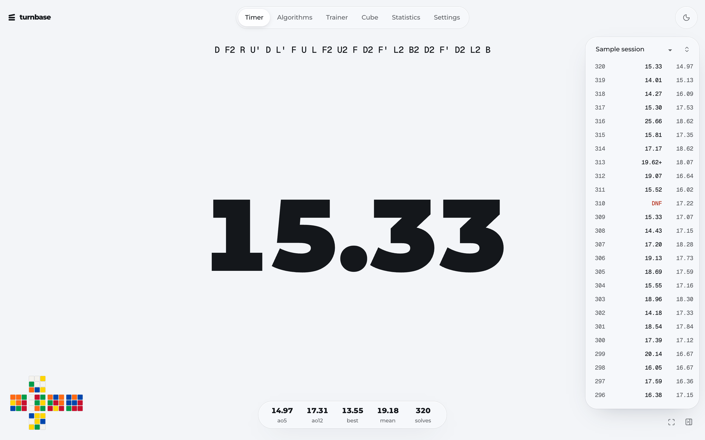

## What it does

**Timer.** Hold Space until the digits turn green, let go to start, and press any key to stop. WCA-style inspection, +2, DNF and DNS, sessions by puzzle, and a focus mode that leaves only the digits on screen during a solve.

**Scrambles.** Random-state 3×3 practice scrambles from [cubing.js](https://js.cubing.net/cubing/), running in a worker with a small buffer, so the next scramble is usually ready when a solve ends. The diagram is computed by applying the scramble to the cube engine.

**Statistics.** Mean of 3 and average of 5 by WCA rules, rolling ao12, ao50, ao100, ao1000 and any window you add. Charts for trends, spread, daily volume, personal bests and consistency, session comparison, CSV and JSON export.

**3D cube.** Turn with the keyboard or by dragging a sticker. Face, slice, wide and whole-cube moves, undo and redo, remappable key profiles, stickered and stickerless styles.

**Algorithms.** All 21 PLL, 57 OLL and 41 F2L cases, plus 2-look and beginner sets. Each case opens on the 3D cube in its true starting state, and plays, steps, reverses and scrubs one exact state at a time.

**Trainer.** Recognition, recall, execution on the virtual cube, flashcards and SM-2 spaced review, with progress by set.

**Themes.** Light by default, on one plain background colour. Six palettes in light and dark, or your own background and accent colours, with optional background glow and adjustable glass. Text contrast is calculated so any combination stays readable.

**Virtual solving.** A timed solve on the 3D cube, recorded move by move with timestamps and replayable at original speed. These go to a separate session, because they are not comparable with physical times.

| | |
|---|---|
| 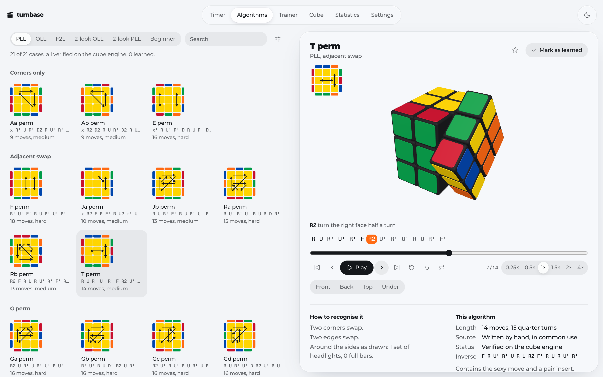 | 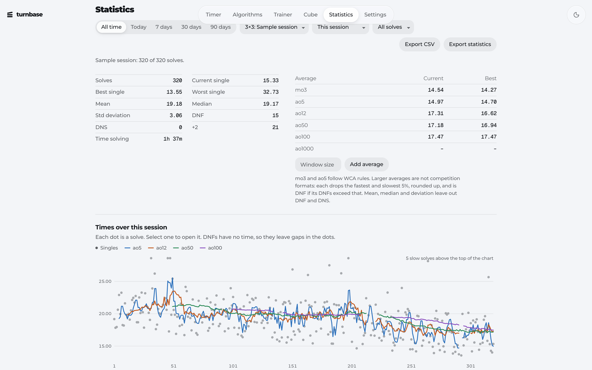 |
| 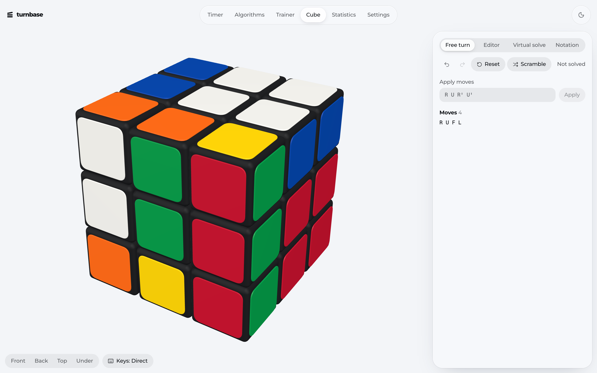 | 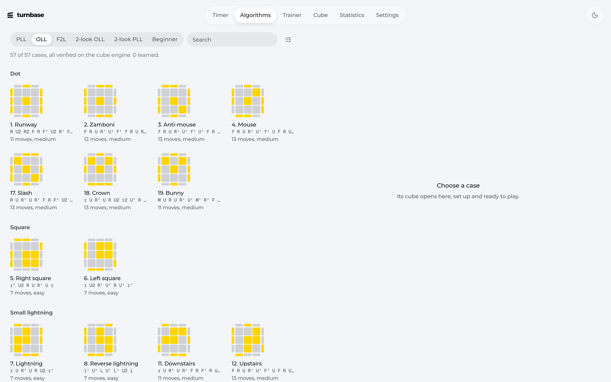 |
| 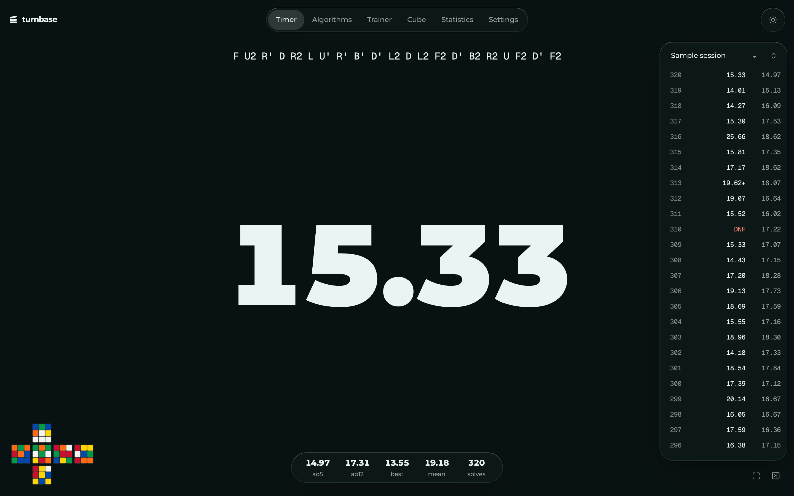 | 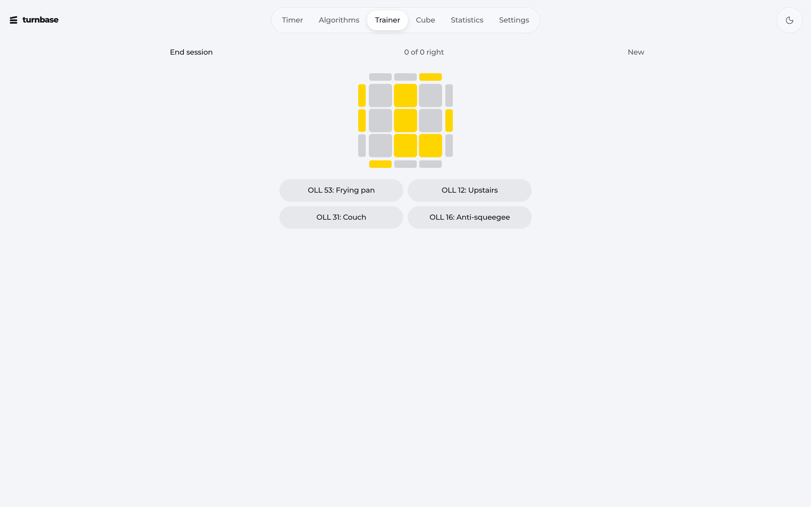 |
| 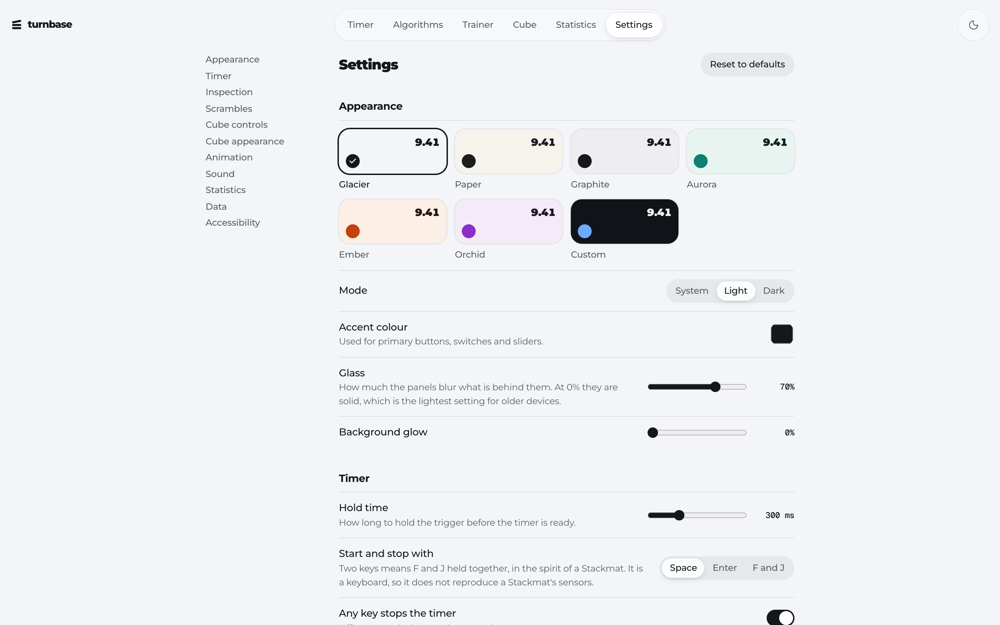 | 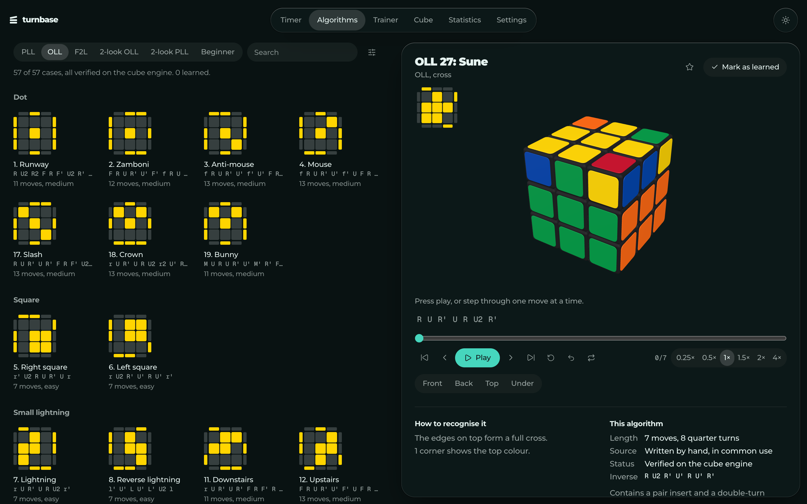 |

<p>
  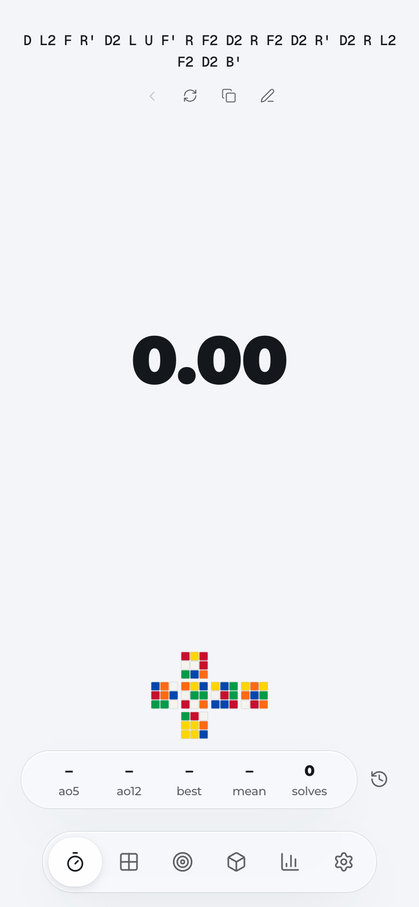
  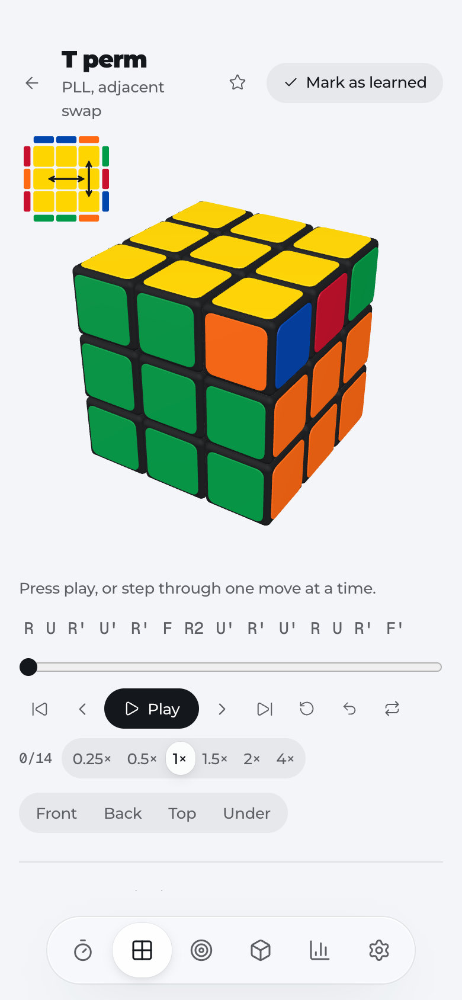
</p>

## Running it

You only need this to work on the code. The app itself is at the link above.

Requires Node 20.19 or newer. It was developed on Node 24.

```bash
npm install
npm run dev
```

The app is then at http://localhost:5210.

```bash
npm run build
npm run preview
```

This serves the production build at http://localhost:5211.

## Testing

```bash
npm test
```

Runs the unit tests with Vitest.

```bash
npx playwright install chromium
npm run test:e2e
```

Runs the browser tests against a production build, with real key presses and real WebGL frames. They include accessibility scans of every page in both themes.

```bash
npm run verify:algorithms
```

Runs only the algorithm library checks.

## WCA rules, and what is unofficial

turnbase is a practice tool. It is not certified competition equipment and its results are not official.

| Area | Follows the WCA Regulations (April 1, 2026 edition) | Unofficial |
|---|---|---|
| Inspection | 15.00 s gives +2 and 17.00 s gives DNF, boundaries included. Calls at 8 and 12 s. | A keyboard is not a Stackmat, and there is no judge. |
| Results | Under 10 minutes truncated to hundredths, 10 minutes and over truncated to seconds (9f1, 9f2). | The optional third decimal is display only. |
| Mean of 3 | Any DNF or DNS makes it DNF (9f10, 9f11). | |
| Average of 5 | Best and worst dropped, with one DNF allowed as the worst (9f8, 9f9). | |
| ao12, ao50, ao100, ao1000 | | Not competition formats. Each drops the fastest and slowest 5% rounded up, and is DNF if its DNFs exceed that. |
| Scrambles | Random-state where the regulations ask for it. | Not official: competitions require TNoodle. |

Inspection penalties sit beside the raw time and never change it, so removing an incorrect penalty restores the exact original result. A practice setting records the penalty you earned without applying it.

## Scrambles

Scrambles come from cubing.js 0.66.1. turnbase labels them as practice scrambles, and each solve stores the exact scramble along with its generator, version and method.

| Puzzle | Generator method | Diagram | 3D cube |
|---|---|---|---|
| 3×3 | Random-state | turnbase | turnbase |
| 2×2 | Random-state | turnbase | turnbase |
| 4×4 | Random-state | turnbase | turnbase |
| 5×5 | Random moves, as Regulation 4b3e specifies | turnbase | turnbase |
| Pyraminx, Skewb, Square-1, Clock | Random-state | cubing.js | None |
| Megaminx | Random moves, as Regulation 4b3e specifies | cubing.js | None |

The uniformity of random-state generation is cubing.js's documented design. The tests here do not attempt to prove it statistically. They check that scrambles parse, produce legal states, are not solved, and undo exactly.

If the generator fails, turnbase shows an error and a retry. It never falls back silently to a weaker scramble.

**Using TNoodle.** turnbase does not run TNoodle. To practise on official scrambles, generate them with [TNoodle-WCA-1.2.3](https://www.worldcubeassociation.org/regulations/scrambles/), then use the pen button beside the scramble to paste each one in. Cube notation is validated first, and the solve records it as entered by you.

## How it is built

JavaScript and JSX, with React, Vite, Three.js, React Three Fiber, Drei, GSAP, Zustand, Tailwind CSS and IndexedDB. Tested with Vitest and Playwright.

```
src/
  timer/       state machine, inspection rules, browser input, solve records
  statistics/  result arithmetic, aggregates, charts
  scrambles/   puzzle registry, generator service, diagrams
  cube/        engine, parser, animation queue, player, renderer, controls
  algorithms/  catalog, validator, search, diagrams, browser
  trainer/     SM-2 scheduling, case sets, progress, replay
  storage/     IndexedDB repositories, backup, migrations
  data/        the algorithm data itself
```

### The timer

The timer is a pure state machine: idle, inspection, holding, ready, running, stopped. Every event carries its own timestamp and a time is the difference between two of them. Those timestamps come from the input events themselves, which share the clock of `performance.now()`, so a busy frame cannot change a recorded time.

While a solve runs, one animation loop writes the digits directly to the DOM. React does not re-render, and Three.js is not loaded on the timer page at all. Key repeat, a lost window focus, key bounce on start and typing in a field are all handled and tested.

While a solve runs, the page drops everything else. The navigation and panels are hidden so nothing composites behind the digits, and glass blur is switched off.

### The look, and frame rate

Big numbers and page titles are set in Montserrat Black, with fixed-width digits so a running time never jitters. Panels are translucent, with backdrop blur, raised saturation and a lit top edge. This imitates liquid glass rather than refracting light through it: true edge refraction is costly and only some browsers support it, so it was left out in favour of frame rate. At 0% the Glass setting makes panels solid, which is the lightest option for older devices.

Selection thumbs, switches and panels move on a spring, using compositor-only properties where possible. Off-screen library sections skip rendering, and each page's code starts loading when the pointer heads for its link.

Measured in the browser tests, in Chromium on Apple silicon at a 60 Hz limit: the running timer held 60 fps with a worst frame of 16.8 ms, and the cube rendered 58 to 59 fps during algorithm playback. Nothing in the code caps the rate, so faster displays should run faster, but that has not been measured.

### The cube

A state is an array with one entry per sticker position, holding which sticker is there. That makes it a permutation, so it cannot hold an arrangement that rotating layers could not reach. Move permutations are derived from 3D geometry instead of written by hand. The same code covers 2×2 through 5×5.

Corners and edges are read from this state when needed, and the three laws of the cube (matching parity, twists summing to 0 mod 3, flips to 0 mod 2) are checked in tests. The engine is also compared against cubing.js's KPuzzle on random sequences of every move family.

The picture cannot drift from the logic, because pieces have fixed places and colours are read straight from the state. The only motion is one layer's rotation during a turn. When the turn ends the rotation is dropped and the exact next state is drawn, so no rotation ever accumulates. Browser tests sample the rendered pixel under each visible sticker and compare it with the engine, including after hundreds of fast turns.

### Notation

A recursive-descent parser handles `R`, `R'`, `R2`, `R2'`, slices, `Rw` and lowercase wide moves, rotations, `(R U R' U')3`, commutators `[A, B]`, conjugates `[A: B]`, nesting and comments. Errors give a position and a reason. Anything ambiguous is an error rather than a guess: lowercase `r` is rejected on a 4×4, and `M` is rejected on even cubes. Expansion is compared with cubing.js's parser in tests.

### Colours

The cube uses the Western scheme: white on U, yellow on D, green on F, blue on B, red on R, orange on L. Library views show the cross on the bottom, by repainting U↔D and L↔R, which changes only the colours and not the logic.

## The algorithm library

| Set | Cases | Complete |
|---|---|---|
| PLL | 21 of 21 | Yes |
| OLL | 57 of 57 | Yes |
| F2L | 41 of 41, front-right slot | Yes |
| 2-look OLL | 10 of 10 | Yes |
| 2-look PLL | 6 of 6 | Yes |
| Beginner | 11 steps | Yes, as a method outline |
| COLL, CMLL, Winter Variation, ZBLL, Roux, 2×2 methods, blindfolded commutators | None | Not included |

No reputable structured dataset for the sets that are not included was validated here, so they are left out rather than filled in. Any of those algorithms can still be pasted into the editor on the Cube page, where it is animated like any other.

### How cases are verified

A case's state is its algorithm run backward from a solved cube, so a picture and its algorithm cannot disagree. That alone would prove little, so `tests/algorithms` also checks:

- **OLL:** the first two layers stay intact, the last layer ends oriented, every variant works from the case, all 57 orientation patterns are distinct, and none is already oriented. Each number's edge shape and corner count is checked against a table.
- **PLL:** the first two layers and orientation stay intact, every variant ends fully solved, all 21 permutations are distinct, and each has its expected corner and edge cycles.
- **F2L:** the cross and the other three slots stay intact, the target pair starts out of place, and every variant solves it. The 41 cases are not taken from a list: `scripts/generate-f2l.mjs` enumerates them from the geometry of the slot.
- **Beginner and 2-look:** each step reaches its stated goal without disturbing what it says it keeps.

The status shown in the app is computed live on the engine, not stored as a label.

As an independent check, on November 5, 2026 every OLL number and PLL name was compared with the public lists at jperm.net, by case state rather than by notation. All 57 and all 21 agreed. That comparison ran once, and nothing from those lists is in this repository.

### Sources

The algorithms are widely circulated sequences, entered by hand and confirmed by the checks above. They were not copied from a database. Five F2L cases use a shortest solution in `<R, U, F>` found by exhaustive search, and others list one as an alternative. The app says which is which.

OLL nicknames are informal and vary between communities, so the number is the identifier. F2L numbering is turnbase's own, by group and then by length, and does not match other sites. Difficulty is an estimate from length and move types.

## Data

Solves, sessions, settings and practice progress live in IndexedDB in your browser. A solve is written the moment it ends, so a refresh does not lose it. Clearing your browser data does, so export a backup from Settings first.

Backups are validated before anything is written, and the import runs in one transaction. Deleting a solve can be undone, and deleting a session asks first.

## Known limitations

- There is no Stackmat hardware support.
- Fingertrick notes are left out, because nothing here could verify them.
- Pyraminx, Skewb, Megaminx, Square-1 and Clock have a timer, scrambles and a 2D diagram, but no virtual cube.
- Physical solves have a free-text reconstruction field, which is not parsed or replayed. Only virtual solves have move-level replay.
- Scramble history is a step back through recent scrambles, not a browsable list.
- Automated browser tests ran in Chromium on macOS. Safari, Firefox and physical phones have not been tested, and mobile was tested through touch emulation.
- Frame rates above 60 Hz have not been measured.
- Sounds have been checked for playing without error, not by ear.
- Solve data does not sync between devices.

## Licences

turnbase is released under the [MIT License](LICENSE). That covers this repository's code. Its dependencies keep their own licences, including these:

- [cubing.js](https://github.com/cubing/cubing.js), MPL-2.0 or GPL-3.0-or-later. It is bundled, unmodified, into `public/vendor/cubing` by `scripts/vendor-cubing.mjs`. Its source is at that link.
- [Three.js](https://github.com/mrdoob/three.js), React Three Fiber, Drei, React, Zustand and Tailwind CSS, MIT.
- [GSAP](https://gsap.com/), under its standard no-charge licence.
- Montserrat and Geist Mono, SIL Open Font License.
- WCA rules are summarised from the [WCA Regulations](https://www.worldcubeassociation.org/regulations/). SM-2 is by Piotr Woźniak.

turnbase is an independent project, not affiliated with the World Cube Association. Rubik's Cube is a trademark of its owner.
